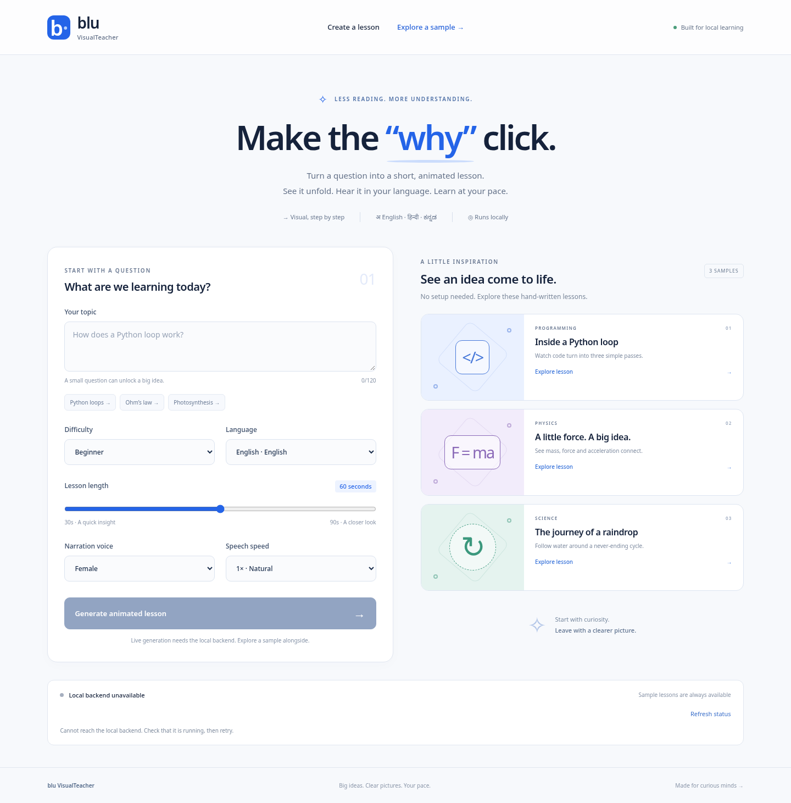

# Blu VisualTeacher

Local animated lessons built with React, TypeScript and Remotion. The website
and MP4 exporter use the same JSON-driven `Lesson` composition.

Implemented: title cards, code walkthroughs, flow/cycle/labelled diagrams,
formulas, recaps, captions, local Noto fonts, a responsive lesson creator/player,
and the typed frontend client for the documented FastAPI endpoints.

Requires Node 24 and local Chromium for rendering. Dependencies are pinned in
`web/package-lock.json`. This checkout has no backend; the three supplied silent
samples work independently. No backend or lesson-schema contracts were changed.

## Preview



[Mobile preview](docs/previews/mobile.png) · [Code walkthrough preview](docs/previews/code-walkthrough.png)

These are screenshots of the running frontend. Samples have mock timing and
no narration; live generation requires the local backend.

## Run locally

```sh
cd web
npm ci
npm run dev
# In another terminal, from web/:
npm run studio
```

Live generation needs Satwik's backend on port 8000. Vite proxies `/api` and
`/media` to it. The UI clearly separates samples from live generation.

Build the website and renderer with `cd web && npm run build:demo`.
Render from the repository root:

```sh
node web/render/render.mjs --props data/samples/python_loop.props.json --out cache/test.mp4 --concurrency 2
```

The exporter emits JSON lines and derives timing from the timeline. It never
downloads a browser at runtime. Set `REMOTION_BROWSER_EXECUTABLE` or
`CHROMIUM_PATH` if auto-discovery does not find your preinstalled browser.
The mock timelines render silently. Real narration uses local media paths and
`audioVariant: "wav"`. Rebundle after changing lesson components.

See [web/README.md](web/README.md) for commands and
[web/VALIDATION.md](web/VALIDATION.md) for evidence and remaining live checks.
Project contracts and licences are under [docs/](docs/README.md).
